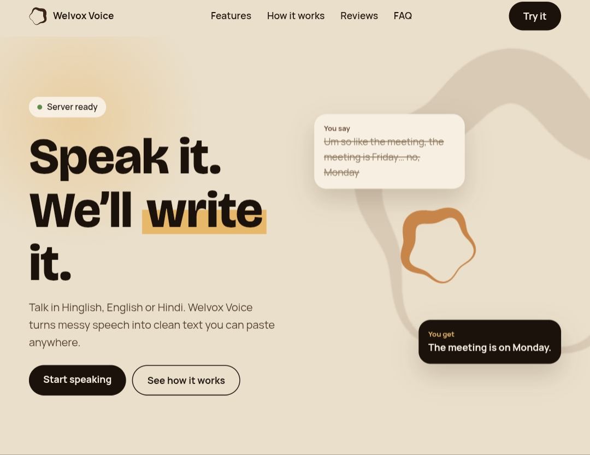

<p align="center"><b>Designed by Piyush Joshi</b></p>

<h1 align="center">Welvox Voice</h1>
<p align="center">
  
</p>

<p align="center"><b>Speak it. We’ll write it.</b><br>
Hinglish, English and Hindi speech, turned into clean text you can paste anywhere.</p>

<p align="center">
  <a href="https://piyush2707.github.io/welvox-voice/"><b>Live demo</b></a> ·
  <a href="https://www.linkedin.com/in/piyush2707/"><b>LinkedIn</b></a> ·
  <a href="https://github.com/piyush2707"><b>GitHub</b></a>
</p>

<p align="center">
  
  
  
  
</p>

---

## Live link

**Try it now: https://piyush2707.github.io/welvox-voice/**

> The backend runs on a free plan that sleeps when idle. The first request after a break can take up to a minute. After that it is fast.

## Contents

- [What is Welvox Voice?](#what-is-welvox-voice)
- [Features](#features)
- [How to use](#how-to-use)
- [Android keyboard (beta)](#android-keyboard-beta)
- [How it works](#how-it-works)
- [Project structure](#project-structure)
- [Run it yourself](#run-it-yourself)
- [API](#api)
- [Deploy](#deploy)
- [Privacy](#privacy)
- [Roadmap](#roadmap)
- [Author](#author)

## What is Welvox Voice?

Most people do not speak in perfect sentences. They pause, repeat themselves, say “um”, and change their mind halfway.

**Welvox Voice** turns the way you really talk into clean, ready-to-send text. It removes fillers and repeats, keeps only your **final correction**, fixes grammar and punctuation, and gives you the result in **Hinglish, English or Hindi**.

**Example**

| You say | You get |
|---|---|
| “haan toh um meeting ko, meeting ko Friday ko rakhte hain, nahi nahi, Monday ko rakh lete hain” | “Meeting Monday ko rakh lete hain.” |

Use it on the **web**, or as an **Android voice keyboard** that types into any app.

## Features

**Core**
- Speak in Hindi, English or a mix, and choose Hinglish, English or Hindi output
- Removes fillers and repeated words
- Keeps only your last correction
- Auto-stop: recording ends about two seconds after you pause

**Make it yours**
- **Templates:** WhatsApp, Email, LinkedIn post, Meeting notes
- **Rewrite buttons:** Shorter, Formal, Casual, Bullets, or switch the language without speaking again
- **Voice commands:** say “Hey Welvox, make this formal” and it rewrites the text on screen
- **My words:** names and terms that are always spelled right
- **Snippets (web):** a short phrase expands into saved text

**Everyday use**
- **History** with search, copy and delete, saved only on your device
- **Image share:** turn a result into a shareable card
- **Install as an app:** add it to your home screen
- **Feedback buttons:** 👍 and 👎 on every result
- **Daily usage limit** per person to keep the service fair

## How to use

**Web**
1. Open the [live demo](https://piyush2707.github.io/welvox-voice/) and allow the microphone.
2. Pick Hinglish, English or Hindi, and an optional template.
3. Tap the logo and speak.
4. Pause for about two seconds. Your clean text appears.
5. Copy it, share it, or reshape it with Shorter, Formal, Casual or Bullets.

**Voice command example:** after a result, tap the logo and say *“Hey Welvox, make this formal.”*

## Android keyboard (beta)

A voice-first keyboard that types the result straight into any app, such as WhatsApp, Gmail or Notes.

**Keys:** mic, language button, template button, backspace, enter, and a globe key to switch back to your normal keyboard.

**Set up**
1. Download the app file from the latest successful run in the **Actions** tab (artifact `welvox-keyboard-apk`), and install it.
2. Open **Welvox Voice** and tap: **Allow microphone**, **Enable the keyboard**, then **Choose Welvox Voice**.
3. Add names in **My words** if you want them always spelled right.
4. In any chat, tap the text box, pick the keyboard, tap the mic and speak.

**Good to know**
- It is a voice keyboard, so it has no letter keys. Switch to your normal keyboard to type.
- It is a debug build. If Android warns you, choose **Install anyway**.
- Uninstall an older version before installing a new one.

## How it works

```
Browser or Android keyboard
        │  records your voice
        ▼
FastAPI backend (Render)
        │  speech to text with Whisper (via Groq)
        │  cleanup, templates, commands with a language model (via Groq)
        ▼
Clean text, typed or shown to you
```

**Built with**
- **Backend:** Python, FastAPI, Groq (Whisper for speech, a language model for cleanup)
- **Web app:** HTML, CSS and JavaScript, hosted on GitHub Pages
- **Android keyboard:** Kotlin, built by GitHub Actions
- **Hosting:** Render (backend), GitHub (everything else)

## Project structure

```
backend/
  main.py                  FastAPI server
  requirements.txt         Python packages
docs/
  index.html               Web app
  manifest.webmanifest     Install-as-app settings
  sw.js                    Service worker
  icon-192.png, icon-512.png
android/                   Voice keyboard (Kotlin)
.github/workflows/
  android.yml              Builds the keyboard app
README.md
```

## Run it yourself

**Requirements:** Python 3.10 or newer and a free [Groq](https://console.groq.com) API key.

```bash
pip install -r backend/requirements.txt
export GROQ_API_KEY=your_key_here
uvicorn backend.main:app --reload
```

**Optional environment variables**

| Name | What it does | Default |
|---|---|---|
| `DAILY_LIMIT` | Requests per person per day | `30` |
| `STT_MODEL` | Speech-to-text model | `whisper-large-v3` |
| `LLM_MODEL` | Cleanup model | `openai/gpt-oss-120b` |

> **Never commit your API key.** Set it in your hosting dashboard (for example Render) or in your own terminal.

## API

| Method | Path | Purpose |
|---|---|---|
| `GET` | `/` | Health check |
| `POST` | `/dictate` | Audio in, clean text out. Fields: `file`, `mode`, `vocab`, `template`, `prev` |
| `POST` | `/rewrite` | Reshape text. Body: `text`, `style` |
| `POST` | `/feedback` | Thumbs up or down. Body: `rating`, `mode`, `note` |

`mode` is `hinglish`, `english` or `hindi`. `template` is `whatsapp`, `email`, `linkedin` or `notes`. `style` is `shorter`, `formal`, `casual`, `bullets`, `hinglish`, `english` or `hindi`.

## Deploy

**Backend (Render web service)**
- Build command: `pip install -r backend/requirements.txt`
- Start command: `uvicorn backend.main:app --host 0.0.0.0 --port $PORT`
- Environment: add `GROQ_API_KEY`

**Web app (GitHub Pages)**
- Settings, then Pages, branch `main`, folder `/docs`

**Android keyboard**
- Push changes under `android/`. The workflow in `.github/workflows/android.yml` builds the app and uploads it as an artifact.

## Privacy

- Your recording is sent to the backend and turned into text by Groq’s speech model. **This project does not keep your recordings.**
- Dictated text is never written to the logs. Feedback votes are logged as a rating and language only.
- Your language, words, snippets and history are stored **only on your own device**.

## Roadmap

- Tone for each app (casual for chats, formal for email)
- Live preview while you speak
- Accounts and plans
- Chrome extension for desktop

Ideas and feedback are welcome. Open an issue or message me on LinkedIn.

## Author

**Designed by Piyush Joshi**, founder of Welvox.

- LinkedIn: [linkedin.com/in/piyush2707](https://www.linkedin.com/in/piyush2707/)
- GitHub: [@piyush2707](https://github.com/piyush2707)
- Live demo: [piyush2707.github.io/welvox-voice](https://piyush2707.github.io/welvox-voice/)
